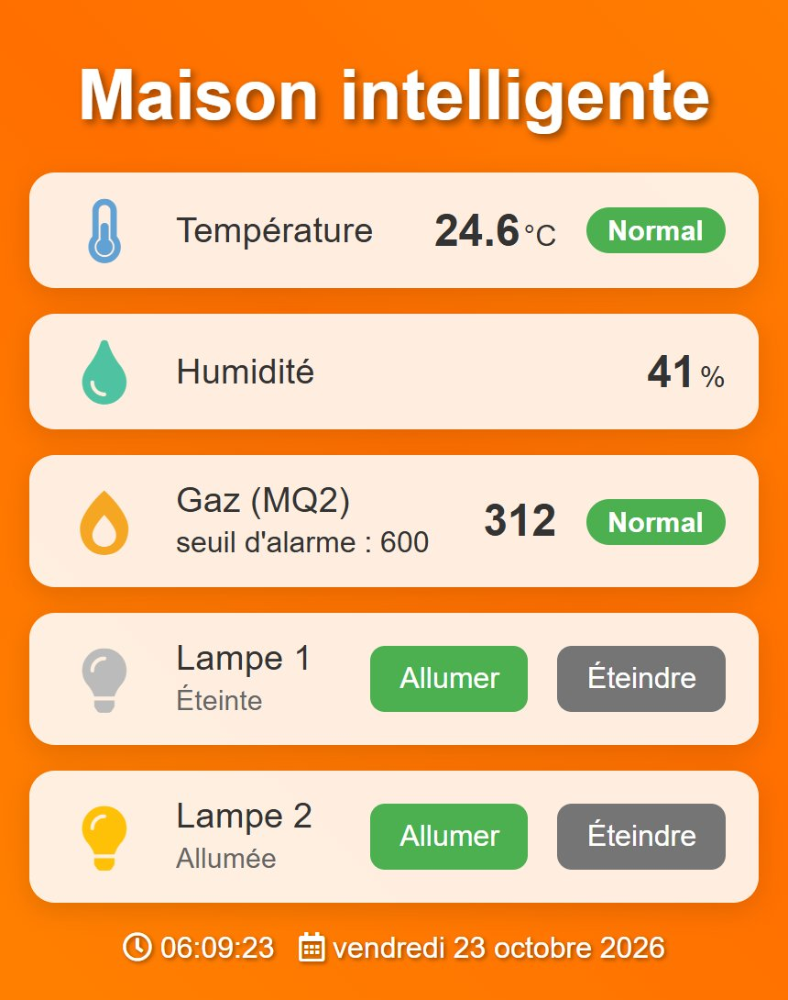
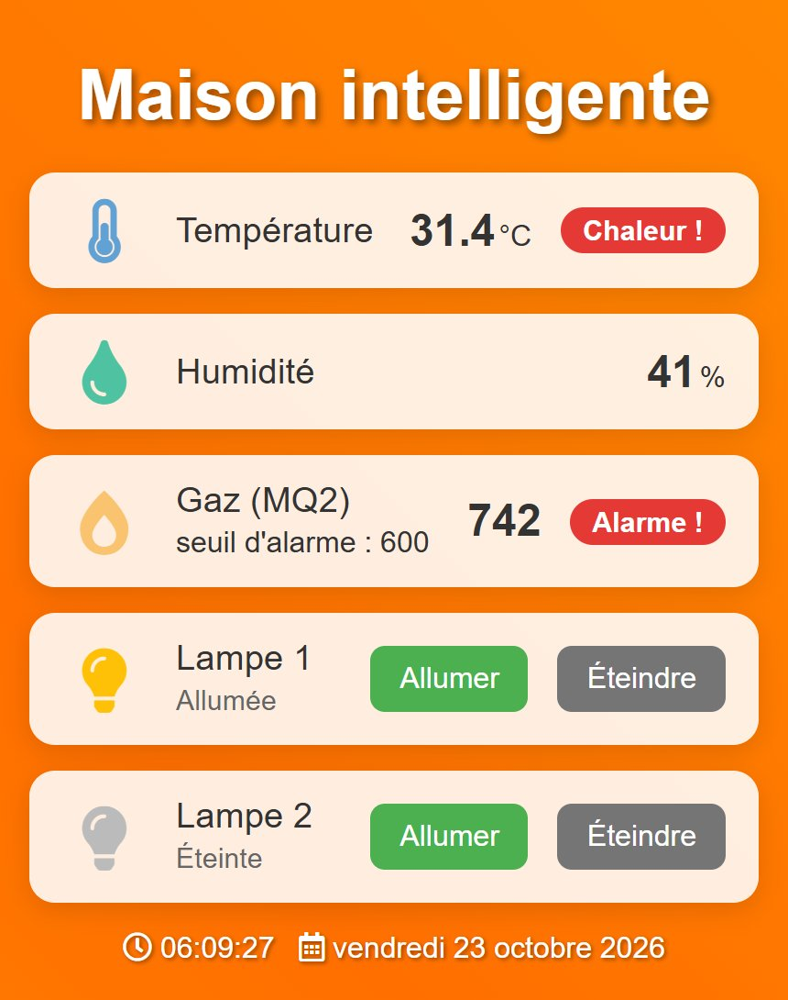

# Maison intelligente — ESP8266

Maquette domotique pilotée par une carte **NodeMCU ESP8266**. La carte héberge un
**serveur web** accessible depuis un téléphone ou un ordinateur sur le même réseau Wi-Fi :
elle affiche la température, l'humidité et le niveau de gaz en temps réel, déclenche
des alarmes locales et permet d'allumer ou d'éteindre deux lampes à distance.

| Tableau de bord | Alarmes gaz et température |
|---|---|
|  |  |

## Fonctionnalités

- **Température et humidité** avec un capteur DHT11, et une **LED d'alerte** au-dessus de 30 °C
- **Détection de gaz** avec un capteur MQ2, et un **buzzer** au-dessus du seuil (600 sur 1023)
- **Commande de deux lampes** depuis la page web, avec leur état affiché
- **Page web embarquée**, adaptée au téléphone, actualisée toutes les 2 secondes
- Les alarmes sont vérifiées **en continu par la carte**, même quand aucune page n'est ouverte

## Fonctionnement

```
 Capteurs ──► ESP8266 (loop : lecture toutes les 2 s, alarmes LED / buzzer)
                 │
                 └── serveur web (port 80)
                       GET /            page web (PageIndex.h)
                       GET /data        mesures et états en JSON
                       GET /led1?state=on|off   lampe 1
                       GET /led2?state=on|off   lampe 2
                                 ▲
        Navigateur (téléphone / PC) ── interroge /data toutes les 2 s
```

Exemple de réponse de `/data` :

```json
{"temperature":24.6,"humidity":41.0,"gas":312,"gasThreshold":600,
 "gasAlarm":false,"tempAlarm":false,"led1":true,"led2":false}
```

## Matériel et câblage

| Composant | Broche NodeMCU | GPIO |
|---|---|---|
| Capteur DHT11 (données) | D7 | 13 |
| Capteur de gaz MQ2 (sortie analogique) | A0 | — |
| Lampe 1 (LED, active à l'état bas) | D1 | 5 |
| Lampe 2 (LED, active à l'état bas) | D2 | 4 |
| LED d'alerte température | D6 | 12 |
| Buzzer | D3 | 0 |

## Installation

1. Installer l'[Arduino IDE](https://www.arduino.cc/en/software), puis le support des cartes ESP8266
   (URL du gestionnaire : `https://arduino.esp8266.com/stable/package_esp8266com_index.json`).
2. Installer les bibliothèques **DHT sensor library** et **Adafruit Unified Sensor** (Adafruit).
3. Copier `maison_intelligente/secrets.example.h` en `maison_intelligente/secrets.h` et y mettre
   le nom et le mot de passe du réseau Wi-Fi.
4. Ouvrir `maison_intelligente/maison_intelligente.ino`, choisir la carte **NodeMCU 1.0 (ESP-12E Module)**
   et téléverser.
5. Ouvrir le moniteur série (115200 bauds) : l'adresse IP de la carte s'affiche. L'ouvrir dans un
   navigateur connecté au même réseau.

Compilation en ligne de commande :

```bash
arduino-cli compile -b esp8266:esp8266:nodemcuv2 maison_intelligente
```

## Technologies

C++ (Arduino), ESP8266WiFi, ESP8266WebServer, bibliothèque DHT, HTML / CSS / JavaScript (fetch, JSON).
